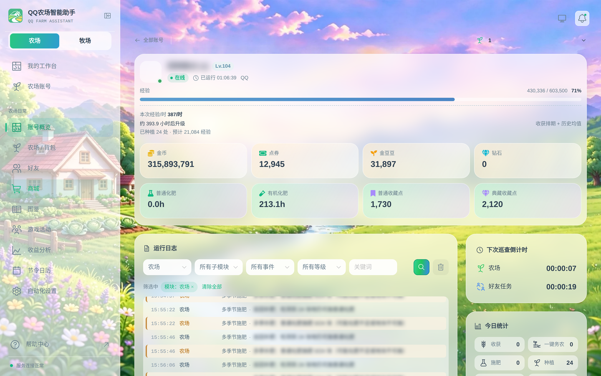
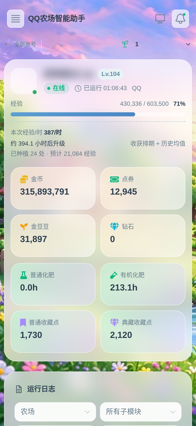

# QQ 农场多账号挂机 + Web 面板

这里提供 QQ 农场助手的正式发布版、安装包和更新说明。应用源码单独维护，此仓库不包含应用源码，也不需要部署者提供个人 GitHub 令牌。

当前正式版本：**v2026.11.25.12** · [版本与更新记录](https://github.com/Anrylin/qq-farm-bot/releases)

## 近期更新

- **红薯资源**：补齐红薯种子、蜜薯、福气币、普通及黄金红薯图片和图鉴配置，活动页、背包与农田共用资源。
- **以薯换福**：每日领种子、红薯种植与收获、蜜薯出售和分享暴击均有独立自动化开关；支持好友价格查询与选铺出售，以及兑换商店查看商品、选择数量、确认费用后手动兑换。收购记录与领取收购提成尚未接入。
- **网页在线更新**：下载完整镜像，备份账号数据，执行健康检查；失败时尝试恢复旧版和备份。支持配置 GHCR 镜像代理及失败后回退直连。
- **独立会话**：已启用独立会话且协议兼容的部署更新时保留 QQ 会话容器；首次迁移、连接中断或协议变化仍可能需要重新登录。
- **QQ 扫码**：完善多人排队、注销确认和二维码刷新限制。
- **界面与日志**：田园背景、玻璃面板、深色模式及手机布局；修复日志超出卡片和长文本换行。

## 当前界面

以下为测试站当前页面截图，账号名称、头像及日志中的隐私信息已做遮挡。

| 登录页（桌面） | 农场概览（桌面） |
| --- | --- |
|  |  |


<details>
<summary>手机端截图</summary>

| 登录页 | 农场概览 |
| --- | --- |
|  |  |

</details>

## 安装与更新

需要 Linux amd64、systemd、Docker Engine、Docker Compose v2、Node.js 20+ 和 util-linux。全新部署下载本仓库 Release 的安装包：

```bash
mkdir qqfarm-deploy
cd qqfarm-deploy
curl -fL --retry 3 -o qqfarm-deploy.tar.gz \
  https://github.com/Anrylin/qq-farm-bot/releases/latest/download/qqfarm-deploy.tar.gz
tar -xzf qqfarm-deploy.tar.gz
sudo bash install.sh --plan
sudo bash install.sh --bind 0.0.0.0 --port 3007
```

默认安装目录 `/opt/qqfarm`。首次登录为 `admin / admin`，请修改密码。已有实例请勿重复安装，进入「设置 → 系统 → 版本与在线更新」检查新版即可。

更新源保持 `Anrylin/qq-farm-bot`，镜像保持 `ghcr.io/anrylin/qq-farm-bot`；旧通用部署沿用原地址。源码仓库调整不会要求部署者登录 GitHub。

- [完整安装与维护说明](DEPLOY.md)
- [正式版下载](https://github.com/Anrylin/qq-farm-bot/releases/latest)
- [本版更新内容](RELEASE_NOTES.md)

本仓库只发布更新清单、安装工具、界面截图与预构建镜像地址。GitHub 自动生成的 Source code 压缩包也只包含这些发布文件，请部署网站时使用 `qqfarm-deploy.tar.gz`。
